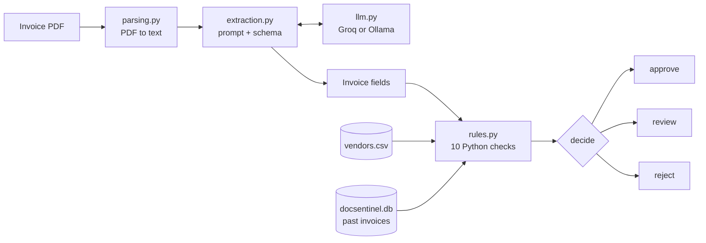

# Architecture

## Current (v0.3): extraction and validation

| File | Job |
| --- | --- |
| `src/docsentinel/parsing.py` | Reads the PDF and returns plain text |
| `src/docsentinel/schemas.py` | Defines the `Invoice` and `LineItem` fields (Pydantic) |
| `src/docsentinel/llm.py` | Returns a Groq or Ollama chat model based on `LLM_PROVIDER` |
| `src/docsentinel/extraction.py` | Sends the text to the model and forces the answer into `Invoice` |
| `src/docsentinel/rules.py` | Plain-Python checks: GSTIN, tax type, tax math, totals, dates, duplicates, vendor, bank account |
| `src/docsentinel/db.py` | SQLite file that remembers processed invoices, to catch duplicates |
| `src/docsentinel/gstin.py` | GSTIN checksum helpers |
| `src/docsentinel/__init__.py` | Command line: `extract` and `validate` |

The LLM only reads. Every approve, review or reject decision comes from Python rules.

## Planned

LangGraph agent with human review and vendor memory (Phase 5), prompt-injection defenses (Phase 6), MCP server (Phase 7). See [ROADMAP.md](ROADMAP.md).