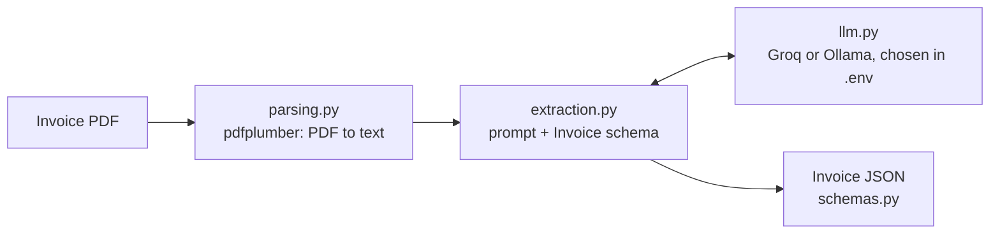

# Architecture

## Current (v0.2): extraction

| File | Job |
| --- | --- |
| `src/docsentinel/parsing.py` | Reads the PDF and returns plain text |
| `src/docsentinel/schemas.py` | Defines the `Invoice` and `LineItem` fields (Pydantic) |
| `src/docsentinel/llm.py` | Returns a Groq or Ollama chat model based on `LLM_PROVIDER` |
| `src/docsentinel/extraction.py` | Sends the text to the model and forces the answer into `Invoice` |
| `src/docsentinel/__init__.py` | Command line: `uv run docsentinel extract <pdf>` |
| `src/docsentinel/gstin.py` | GSTIN checksum helpers (used by the generator now, by rules in Phase 3) |

## Planned

Validate (Python rules) → Decide (approve, review, reject) → Human review → Save, with an MCP server, evaluation and tracing around it. See [ROADMAP.md](ROADMAP.md).